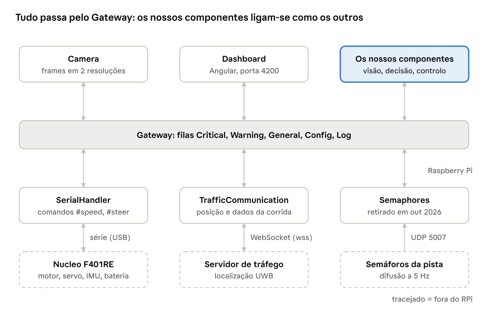

# BFMC 2027 — Guia da Equipa

Atualizado a 16 nov 2026 · Versão online: https://claude.ai/artifact/LX7vpdDrMsnmxfkpzqUH4h

## Índice

1. [Resumo rápido](#resumo-rápido)
2. [A competição e o calendário](#a-competição-e-o-calendário)
3. [A pista e as regras de trânsito](#a-pista-e-as-regras-de-trânsito)
4. [Pontuação e regras importantes](#pontuação-e-regras-importantes)
5. [O hardware do carro](#o-hardware-do-carro)
6. [Os repositórios oficiais](#os-repositórios-oficiais)
7. [Brain (Raspberry Pi): a arquitetura](#brain-raspberry-pi-a-arquitetura)
8. [Embedded (Nucleo): protocolo, build e calibração](#embedded-nucleo-protocolo-build-e-calibração)
9. [V2X: localização, servidor de tráfego e semáforos](#v2x-localização-servidor-de-tráfego-e-semáforos)
10. [Simulador e desenvolvimento sem o carro](#simulador-e-desenvolvimento-sem-o-carro)
11. [Setup: como começar](#setup-como-começar)
12. [O que temos de construir e o roadmap](#o-que-temos-de-construir-e-o-roadmap)
13. [Links e recursos](#links-e-recursos)

## Resumo rápido

Este guia junta num só sítio tudo o que precisamos para a BFMC 2027: regras, calendário, hardware, código base, V2X e links. Quando alguém descobrir algo novo, acrescenta aqui.

- **Objetivo:** pôr um carro à escala 1:10 a conduzir sozinho numa pista-cidade, cumprindo as regras de trânsito.
- **Próxima entrega:** Relatório 1 a 21 de dezembro de 2026. O carro tem de andar controlado com o código base.
- **Prova eliminatória:** vídeo de qualificação a 8 de março de 2027 (lane keeping, cruzamentos e sinais).
- **Final:** Cluj-Napoca (Roménia), em meados de maio de 2027.
- **Onde se programa:** sobretudo no **Brain** (Python, no Raspberry Pi). O firmware da Nucleo (C++) só se mexe para calibrar.
- **Sem o carro:** dá para desenvolver quase tudo no PC (modo `--dev` e simulador Gazebo). O carro serve para calibrar, afinar e gravar vídeos para a visão.

Links principais:

- [Regulamento oficial](https://regulation.boschfuturemobility.com/)
- [Documentação técnica](https://documentation.boschfuturemobility.com/)
- [Repositórios ECC-BFMC](https://github.com/ECC-BFMC)
- [Site da competição](https://boschfuturemobility.com/)

## A competição e o calendário

A BFMC é organizada pelo Bosch Engineering Center Cluj em parceria com o IEEE-ITSS. A edição de 2027 é a 10.ª. Todas as entregas fecham às **23:59, hora da Roménia** (mais 2 horas que Portugal), e o que chegar atrasado é descartado.

| Data | Entrega | O que tem de mostrar |
| --- | --- | --- |
| 15 dez 2026 | Primeiros passos | Foto da equipa, para os media |
| 21 dez 2026 | Relatório 1 | Carro controlado com o código base |
| 1 fev 2027 | Relatório 2 | Uma entrada ligada a uma saída (por exemplo, câmara → direção) |
| 8 mar 2027 | **Qualificações** (passa ou chumba, até 20 equipas) | Lane keeping e reação básica a obstáculos |
| 11 abr 2027 | Pedido de carta-convite para o visto | Só para quem precisa |
| 12 abr 2027 | Relatório 3 | Percursos complexos em cruzamentos e reação a obstáculos |
| 16 abr 2027 | Vídeo de marketing e preparação da viagem | Só equipas qualificadas |
| meados de mai 2027 | Final em Cluj-Napoca (data exata por anunciar) | Ver a sequência de dias abaixo |

**Cada relatório** tem um PDF de no máximo 2 páginas e um vídeo de no máximo 3 minutos (50 MB). No GitHub, temos de manter atualizados `docs/monitoring/` (plano e arquitetura) e `docs/project status/`. A Bosch avisa que copiar os exemplos sem adaptar tira pontos.

**Vídeo de qualificação:**

- No máximo 5 minutos, gravado numa só sequência. Pode-se reposicionar o carro à mão e alterar a pista por falta de espaço.
- Tem de mostrar: atravessar um cruzamento; lane keeping; a manobra completa depois dos sinais de stop, passadeira, prioridade e estacionamento; e mudança de velocidade nos sinais de entrada e saída da autoestrada.

**Dias em Cluj** (chegamos na véspera do dia 1 e saímos no dia a seguir ao dia 5, cerca de 7 dias no total):

1. Dia 1: briefing de abertura e networking.
2. Dias 1 a 3: testes na pista, 3 slots de 20 minutos por dia.
3. Dia 4: semifinais, em dois grupos de até 10 equipas. Passam 4 de cada grupo.
4. Dia 5: final.

O alojamento e as refeições em Cluj são pagos pela Bosch. A viagem fica a cargo da equipa. Fonte: [Project development](https://regulation.boschfuturemobility.com/data/projectdevelopment.html) e [Competition days](https://regulation.boschfuturemobility.com/data/competitiondays.html).

## A pista e as regras de trânsito

A pista imita uma cidade. O carro tem de conduzir pela direita, obedecer aos sinais e semáforos e reagir a peões e a outros carros.

**Elementos da pista:** retas, curvas, passadeiras, estradas de sentido único e de dois sentidos, autoestrada com separadores, cruzamentos de 3 e 4 vias, estacionamento paralelo, rotunda, rampa antes da autoestrada, túnel na curva de velocidade, troços sem marcações e faixa de autocarro.

**Regras de condução:**

- Conduzir pela direita, na faixa da direita.
- Linha tracejada: pode ultrapassar se for seguro. Linha contínua: segue atrás do carro da frente.
- Na autoestrada usa-se a segunda faixa (a da margem).
- A rotunda faz-se no sentido anti-horário.
- Velocidade mínima: 20 cm/s na cidade e 40 cm/s na autoestrada.
- Nunca tocar na faixa do autocarro.

**Sinais, semáforos e obstáculos:**

| Elemento | O carro tem de |
| --- | --- |
| Stop | Parar 3 segundos antes do cruzamento |
| Prioridade | Entrar no cruzamento sem parar |
| Estacionamento | Abrandar, encontrar um lugar livre e estacionar |
| Passadeira | Abrandar. Se houver um peão, parar até ele atravessar |
| Entrada de autoestrada | Passar às regras de autoestrada (velocidade mínima 40 cm/s) |
| Saída de autoestrada | Voltar às regras de cidade |
| Rotunda | Entrar na rotunda e circular no sentido anti-horário |
| Sentido único | Seguir o sentido indicado |
| Sentido proibido | Não entrar |
| Semáforo | Vermelho: parar. Verde: avançar. Amarelo: avançar com cuidado |
| Peão na estrada (fora da passadeira) | Parar e esperar |
| Carro parado (avariado ou estacionado) | Ultrapassar, se a linha for tracejada |
| Carro em movimento | Seguir atrás ou ultrapassar, conforme a linha |

**Medidas úteis para a visão:**

- Os sinais têm 6 × 6 cm e estão num poste, a cerca de 20 cm de altura. São colocados junto ao elemento a que se referem (cruzamento, passadeira, estacionamento, etc.).
- Há 5 semáforos, com 24 cm de altura e luzes de 4.5 cm: um na partida e quatro no cruzamento com semáforos.
- Os peões são bonecos. Os carros-obstáculo são iguais ao nosso, mas com outra carroçaria.
- A iluminação varia: há zonas à sombra e sol direto, e mudam de posição.

Nota: o regulamento diz que as faixas têm cerca de 35 cm de largura, mas também que "as linhas têm 2 cm". Confirmar as medidas na página Road markings da [documentação](https://documentation.boschfuturemobility.com/).

Fontes: [The track](https://regulation.boschfuturemobility.com/data/track.html), `Documentation/source/data/racetrack/`.

## Pontuação e regras importantes

A maior parte dos pontos vem da corrida técnica: 120 dos cerca de 190 pontos possíveis.

| Componente | Pontos | Como se ganha |
| --- | --- | --- |
| Corrida técnica | até 120 | Estilo Pac-Man: o carro apanha pontos virtuais pela pista, 3 pts cada, em 10 minutos. Cada ponto só conta uma vez. Partir de uma posição aleatória escolhida pelo júri dá +15 |
| Desempenho geral | até 40 | Avaliação subjetiva do júri: comportamento, robustez, coesão do sistema e inovação |
| Desenvolvimento do projeto | até 15 | Relatório, vídeo e repo GitHub, de 0 a 5 cada |
| Mapa no servidor | até 15 | Semelhança entre os dados que o carro envia ao servidor e o que fez de facto na corrida |
| Arena (só na final) | -20 a +20 | Todos os carros na pista ao mesmo tempo, durante 5 minutos e sem GPS. Equipa nova: +20 se acabar com menos de 10 pontos de penalização, -10 se não acabar |

**Penalizações na corrida técnica:**

| Falta | Pontos | Exemplos |
| --- | --- | --- |
| Colisão grave | -2.5 | Bater num carro ou num peão, precisar de ser reposicionado à mão, não parar para um peão |
| Faixa errada | -2.0 | Circular do lado errado, usar mal a autoestrada, falhar a rotunda |
| Sinalização | -1.5 | Passar um semáforo vermelho, não parar no stop, não ceder a passagem, não estacionar depois do sinal |
| Manobra falhada | -1.0 | Estacionamento incompleto, regresso mal feito à faixa depois de ultrapassar, estacionar onde não é permitido |

**Como funciona a corrida:**

- O carro parte da linha de partida atrás de um semáforo vermelho, que o júri põe verde. Em alternativa, parte de um ponto aleatório escolhido pelo júri.
- Pode-se anular uma tentativa nos primeiros 60 segundos. Isso apaga as penalizações, mas o tempo continua a contar.
- O carro tem de enviar os dados da corrida para o servidor de tráfego.
- Na arena, se o carro não arrancar em 1 minuto, a equipa é eliminada.

**Prémios:** 5000 € para o 1.º lugar, 4000 € para o 2.º, 3000 € para o 3.º, e um prémio de marketing. Os finalistas ficam com o carro.

**Regras que não podemos esquecer:**

- **Durante a corrida ninguém comanda o carro.** Só o carro e o dashboard no PC principal da equipa podem estar a correr, e a corrida arranca pelo dashboard. Qualquer comunicação não autorizada dá desclassificação imediata.
- **Cloud:** é permitida, mas os serviços e o dispositivo de internet têm de ser declarados antes dos testes.
- **Modificações ao carro:** cada uma tem de ser pedida no fórum oficial, com link para o fornecedor, e aprovada. O orçamento máximo é 1000 € com IVA.
- **Tamanho:** nada pode passar a largura nem o comprimento da carroçaria, nem 30 cm de altura a partir do chão.
- **Equipa:** no máximo 4 membros mais o líder. Só se pode juntar um membro novo, entre a aceitação e as qualificações.
- **Código:** tem de ser escrito pela equipa. Ajuda direta de pessoas de fora pode dar desclassificação.

Fontes: [Scoring and prizes](https://regulation.boschfuturemobility.com/data/scoringandprizes.html), [Additional aspects](https://regulation.boschfuturemobility.com/data/additional.html).

## O hardware do carro

O carro tem dois cérebros. O **Raspberry Pi 5** trata das decisões e da visão. A **Nucleo F401RE** controla os motores e lê os sensores. Os dois falam por um cabo USB-miniUSB (porta série). O kit chega montado.

| Componente | Modelo | Função |
| --- | --- | --- |
| Chassis | Reely TC-04, à escala 1:10 | Estrutura base |
| Brain | Raspberry Pi 5 (8 GB) com cooler ativo | Corre o projeto Brain em Python: visão, decisão, V2X, dashboard |
| Controlador | Nucleo F401RE (STM32) | Corre o firmware Embedded em C++/Mbed: motor, direção, IMU, bateria |
| Câmara | Raspberry Pi Camera Module 3, grande-angular | O sensor principal |
| IMU | BNO055 (há 3 versões da placa) | Orientação e aceleração |
| Motor | Quickrun Fusion SE 1200KV, brushless com ESC integrado | Velocidade |
| Servo | RS-610WP ou semelhante | Direção |
| Power board | Placa de distribuição de energia | Alimenta o sistema e envia alertas de bateria |
| Bateria | LiPo 2S, 4500 a 6200 mAh, com carregador | Só vem no kit em envios dentro da UE |
| Outros | Cartão microSD, cabo da câmara (30 cm), cabo USB-C do RPi, carroçaria em Lexan | — |

**Melhorias mecânicas:** a documentação tem um guia para subir a altura do carro, aumentar o ângulo de direção e reduzir o atrito. Lembrem-se que qualquer alteração tem de ser aprovada no fórum.

**Cuidado com a LiPo:** carregar sempre com o carregador do kit e nunca descarregar demasiado. A power board avisa quando a bateria está baixa.

O diagrama de ligações completo, com os pinos GPIO, está em [Hardware → Connection diagram](https://documentation.boschfuturemobility.com/data/hardwaresetupofcar.html). Os esquemas das placas IMU e de energia estão em `Documentation/source/PCB/`.

## Os repositórios oficiais

A organização [ECC-BFMC](https://github.com/ECC-BFMC) no GitHub tem o kit inicial que a Bosch dá a todas as equipas. O nosso código deve ficar num **fork do Brain**, porque o regulamento avalia o repositório GitHub da equipa.

| Repo | O que tem | Para nós |
| --- | --- | --- |
| [Brain](https://github.com/ECC-BFMC/Brain) | Código Python do Raspberry Pi: processos, gateway, câmara, série, dashboard Angular, máquina de estados | É onde vamos trabalhar quase sempre |
| [Embedded_Platform](https://github.com/ECC-BFMC/Embedded_Platform) | Firmware C++/Mbed OS da Nucleo | Para calibrar ou adicionar sensores |
| [Shared](https://github.com/ECC-BFMC/Shared) (branch `data`) | Os clientes V2X: TrafficCommunication e Semaphores. Entra no Brain como submódulo em `src/data` | Só usar, não deve ser preciso alterar |
| [Simulator](https://github.com/ECC-BFMC/Simulator) | Simulador Gazebo com ROS 1 Noetic: pista, sinais, carro | Para testar o percurso e as decisões |
| [Computer](https://github.com/ECC-BFMC/Computer) | Servidores simulados para correr no PC (tráfego e semáforos) | Para testar a comunicação V2X em casa |
| [Documentation](https://github.com/ECC-BFMC/Documentation) | Fontes da documentação, mapas da pista em SVG e grafo `.graphml`, PDF dos sinais, modelos 3D, esquemas das placas | Recursos para construir uma pista de teste e para o planeamento do percurso |

Os repos `Brain_ROS` e `Startup_C` estão marcados como **NOT SUPPORTED**. Podemos ignorá-los.

Para clonar o Brain já com o submódulo:

```bash
git clone --recurse-submodules https://github.com/ECC-BFMC/Brain.git
# se já estiver clonado:
git submodule update --init
```

## Brain (Raspberry Pi): a arquitetura

O Brain é um conjunto de **processos Python independentes** que só comunicam através de mensagens, passando pelo **Gateway**. Para acrescentarmos uma funcionalidade nova (visão, controlo, etc.), criamos um processo novo e ligamo-lo às mensagens que precisa.



Nenhum processo fala diretamente com outro: tudo passa pelo Gateway. As caixas a tracejado ficam fora do Raspberry Pi.

**Processos que já existem** (arrancados em `main.py`):

| Processo | Pasta | O que faz |
| --- | --- | --- |
| Gateway | `src/gateway/` | Distribui as mensagens entre os processos. Arranca sempre |
| Camera | `src/hardware/camera/` | Captura dois streams (alta e baixa resolução), grava vídeo e aceita configurações (brilho, contraste) |
| SerialHandler | `src/hardware/serialhandler/` | Envia comandos à Nucleo (`threadWrite`) e lê as respostas e os sensores (`threadRead`) |
| Dashboard | `src/dashboard/` | Backend Python mais frontend Angular na porta 4200: condução manual, calibração, firmware, Wi-Fi, consola |
| TrafficCommunication | `src/data/` (submódulo) | Cliente do servidor de localização e tráfego, por WebSocket |
| Semaphores | `src/data/` (submódulo) | Retirado do Brain em outubro de 2026. Confirmar no fórum como vão funcionar os semáforos |

**Como funcionam as mensagens:**

- Existem 5 filas, por ordem de prioridade: `Critical`, `Warning`, `General`, `Config` (para subscrever e cancelar subscrições) e `Log`.
- Cada tipo de mensagem é uma classe em `src/utils/messages/allMessages.py`, com `Queue`, `Owner`, `msgID` e `msgType`. Por exemplo: `mainCamera` e `LaneKeeping` vêm da câmara; `SpeedMotor`, `SteerMotor` e `Brake` vêm do dashboard; `CurrentSpeed`, `ImuData` e `BatteryLvl` vêm da Nucleo.
- Para mensagens novas, acrescentamos uma classe nesse ficheiro.
- Quem envia usa um `messageHandlerSender`. Quem recebe usa um `messageHandlerSubscriber`, em modo `fifo` (todas as mensagens) ou `lastOnly` (só a mais recente).

```python
from src.utils.messages.allMessages import mainCamera, SpeedMotor, SteerMotor
from src.utils.messages.messageHandlerSender import messageHandlerSender
from src.utils.messages.messageHandlerSubscriber import messageHandlerSubscriber

# no __init__ da thread
self.cameraSub = messageHandlerSubscriber(self.queuesList, mainCamera, "lastOnly", True)
self.steerSender = messageHandlerSender(self.queuesList, SteerMotor)

# no ciclo de trabalho (thread_work)
frame = self.cameraSub.receive()   # devolve None se não houver nada
if frame is not None:
    angle = calcular_direcao(frame)  # a nossa lógica
    self.steerSender.send(str(angle))
```

**Criar um componente novo:**

1. Correr `python3 scripts/newComponent.py` na pasta do Brain.
2. Indicar o nome (por exemplo `LaneDetection`) e a categoria, que é a pasta dentro de `src/` (por exemplo `perception`).
3. O script cria `process<Nome>.py` e `threads/thread<Nome>.py` a partir dos templates `WorkerProcess` e `ThreadWithStop`, e acrescenta as linhas necessárias em `main.py`.
4. Escrever a lógica em `thread_work()`. Se o componente tiver de reagir a mudanças de modo, implementar também `state_change_handler()`.

**Máquina de estados** (`src/statemachine/`):

- Os modos são `DEFAULT`, `AUTO`, `MANUAL`, `LEGACY` e `STOP`. Cada modo define que processos ficam ativos e a resolução da câmara (720p no DEFAULT, 480p no AUTO).
- As transições vêm dos botões do dashboard e estão validadas em `transitionTable.py`.
- Podemos acrescentar modos nossos (detalhes na página *Brain → State machine* da documentação).
- Esta é a máquina de **modos do sistema**. A máquina de estados de **condução** (seguir a faixa, parar no stop, estacionar, etc.) somos nós que a fazemos.

**Outros pontos úteis:**

- **Modo `--dev`:** a Nucleo é simulada em `sim/serial` e a câmara em `sim/picamera2`, que gera imagens sintéticas e não da pista. Dá para desenvolver no PC sem o carro.
- **Serviços do RPi** (`services/`): arranque automático do Brain e do dashboard, e um fallback de Wi-Fi.
- **Testes:** `pytest` na raiz. O CI está em `.github/workflows/ci.yml` e o lint em `ruff.toml`.
- **Documentação do projeto:** `docs/monitoring/` tem o plano e a arquitetura, e `docs/project status/` tem os exemplos de relatórios. Temos de substituir estes ficheiros pelos nossos.

## Embedded (Nucleo): protocolo, build e calibração

A Nucleo recebe comandos de texto do Raspberry Pi pela porta série e controla o motor, o servo e os sensores. Na maior parte do tempo não é preciso mexer neste código. Só o abrimos para calibrar ou para acrescentar um sensor.

**Formato dos comandos:** `#<comando>:<valor1>;<valor2>;;\r\n`. Por exemplo, `#speed:150;;` põe o carro a 150 mm/s e `#kl:30;;` liga a ignição. No Brain, quem constrói estes comandos é o `messageconverter.py`. Na Nucleo, a tabela de comandos está em `source/main.cpp`.

| Comando | Argumentos | O que faz |
| --- | --- | --- |
| `kl` | modo: 0, 15 ou 30 | "Ignição": 0 desliga tudo, 15 liga os sensores, 30 liga os motores. **Sem kl 30, a Nucleo recusa os comandos de movimento** |
| `speed` | velocidade | Velocidade em mm/s, de -500 a 500 por defeito. Os valores negativos andam para trás |
| `steer` | ângulo | Direção, de -250 a 250 por defeito (provavelmente décimas de grau). Positivo vira à direita, negativo à esquerda |
| `brake` | ângulo | Trava, mantendo a direção indicada |
| `vcd` | velocidade; direção; tempo | Anda a uma velocidade e direção durante um tempo |
| `vcdCalib` | velocidade; direção; tempo | Igual ao `vcd`, mas para a calibração |
| `steerLimits` | pedido | Devolve os limites atuais da direção |
| `imu`, `battery`, `instant`, `resourceMonitor` | ativar (0 ou 1) | Liga ou desliga o envio periódico de IMU, bateria, consumo e uso de memória |
| `batteryCapacity` | capacidade | Define a capacidade da bateria em mAh |
| `alive` | ativar | Sinal de vida entre os dois lados |

**Estrutura do código** (`Embedded_Platform/`):

- `drivers/`: motor, servo, IMU BNO055 e o `serialmonitor`, que interpreta os comandos.
- `brain/`: máquina de estados do robô, gestor do kl e da bateria.
- `periodics/`: tarefas que correm periodicamente (IMU, tensão, consumo, alertas, LED).
- `newComponent/newComponent.py`: gera o template de um componente novo.

**Build e flash:**

```bash
pip install mbed-tools          # mais o compilador GCC ARM
cd Embedded_Platform
mbed-tools deploy               # descarrega o Mbed OS
mbed-tools compile -m NUCLEO_F401RE -t GCC_ARM        # compilar
mbed-tools compile -m NUCLEO_F401RE -t GCC_ARM -f     # compilar e fazer flash
```

Em alternativa, liga-se a Nucleo por USB e copia-se o `.bin` de `cmake_build/NUCLEO_F401RE/develop/GCC_ARM/` para a drive `NUCLEO_F401RE` que aparece no PC. O LED pisca a verde e vermelho durante o flash. O dashboard também consegue atualizar o firmware: o binário fica em `Brain/runtime/firmware/`.

**Calibração** (fazer logo que o carro chegue):

1. No dashboard, correr a calibração de velocidade e de direção.
2. O dashboard gera um arquivo com `speedingmotor.cpp` e `steeringmotor.cpp`. Estes ficheiros já trazem `calibrated = 1`, os novos limites e os coeficientes.
3. Copiar os dois ficheiros para `Embedded_Platform/source/drivers/`, por cima dos atuais.
4. Compilar e fazer flash.

Documentação: [Embedded platform](https://documentation.boschfuturemobility.com/) (*Preliminary setup*, *Build and flash*, *Calibration*, *Debugging*).

## V2X: localização, servidor de tráfego e semáforos

Na pista, o carro recebe a sua posição e o estado dos semáforos, e tem de enviar dados para o servidor. Esse envio vale os **15 pontos do mapa no servidor**. O código cliente já vem pronto em `Brain/src/data/`. Do nosso lado, só temos de lhe passar os dados.

**Localização (UWB):**

- Uma caixa em cima do carro, com uma tag Qorvo MDEK1001, é localizada por âncoras UWB.
- O carro recebe a posição através do servidor de tráfego, no formato `{"x": m, "y": m, "z": m, "quality": %}`.
- O erro é de cerca de 20 cm e o atraso pode chegar a 0.5 s. A frequência escolhe-se entre 0.2 e 5 Hz.
- **Na arena não há GPS**, por isso o carro não pode depender só disto.
- Para replicar o sistema em casa, um kit de 12 placas custa cerca de 300 USD (ver *Race Track → Localization*).

**Servidor de tráfego (TrafficCommunication):**

1. **Desde outubro de 2026, o cliente usa WebSocket.** Liga-se a `wss://locsys.boschfuturemobility.com` (configurável em `TRAFFIC_WS_URL`). O cliente antigo, por UDP 9000 e TCP, foi retirado.
2. A autenticação é feita com um token Bearer: a API key do LocSys em `TRAFFIC_DEVICE_TOKEN` (ou `DEVICE_TOKEN_<id>`), no ficheiro `.env`. O carro subscreve o ID do seu dispositivo de localização.
3. A partir daí, o carro mete os dados na memória partilhada e o cliente envia-os. Cada envio leva um carimbo de tempo sincronizado com o servidor:

```python
shared_memory.insert("deviceSpeed", [8.1])          # cm/s, a 1 Hz
shared_memory.insert("devicePos", [12.3, 6.9])      # x, y em metros, a 1 Hz
shared_memory.insert("deviceRotation", [191])       # graus, sentido horário, 0 = orientação inicial, a 1 Hz
shared_memory.insert("historyData", [2, 7.2, 3.8])  # id do obstáculo, x, y. Uma vez por obstáculo
```

O regulamento exige enviar a velocidade e a posição pelo menos de 3 em 3 segundos.

**IDs dos obstáculos** para o `historyData`:

| ID | Obstáculo | ID | Obstáculo |
| --- | --- | --- | --- |
| 1 | Sinal de stop | 8 | Sinal de sentido único |
| 2 | Sinal de prioridade | 9 | Sinal de sentido proibido |
| 3 | Sinal de estacionamento | 10 | Carro estacionado |
| 4 | Sinal de passadeira | 11 | Peão na passadeira |
| 5 | Entrada de autoestrada | 12 | Peão na estrada |
| 6 | Saída de autoestrada | 13 | Bloqueio da estrada |
| 7 | Sinal de rotunda | 14 | Semáforo |

**Semáforos:**

- Segundo a documentação, cada semáforo transmite por UDP, na porta 5007 e a 5 Hz, a sua posição e o estado: 0 = vermelho, 1 = amarelo, 2 = verde. O ciclo é vermelho → verde → amarelo → vermelho.
- **Atenção:** em outubro de 2026, a Bosch retirou do código do Brain o cliente de semáforos. Temos de confirmar no fórum como é que os semáforos vão comunicar este ano.
- Seja como for, o carro tem de detetar os semáforos pela câmara.

**Para testar em casa**, o repo `Computer` tem `carsAndSemaphoresStreamSIM`, que simula os semáforos e os outros carros, e `trafficCommunicationServer`, que simula o servidor de tráfego.

Documentação: *V2X → Traffic Communication, Semaphores, Simulated servers*, na [documentação técnica](https://documentation.boschfuturemobility.com/).

## Simulador e desenvolvimento sem o carro

Dá para desenvolver quase tudo no PC e afinar depois no carro. A exceção é a visão: não se simula bem e tem de ser feita com imagens reais.

| Ferramenta | Serve para | Não serve para |
| --- | --- | --- |
| Brain em modo `--dev` | Arquitetura, componentes novos, fluxo de mensagens, dashboard, máquina de estados | Visão, porque a câmara simulada gera imagens sintéticas |
| Simulador Gazebo | Planear o percurso, decidir o comportamento nos cruzamentos e testar a máquina de estados de condução | Visão (as imagens são muito diferentes das reais). A Bosch avisa: "não caiam na armadilha de passar o tempo a desenvolver o simulador" |
| Vídeos gravados no carro | Desenvolver e testar a visão no PC: faixas, sinais, semáforos, peões | — |
| Repo `Computer` | Simular o servidor de tráfego e os semáforos | — |
| Carro real | Calibrar, afinar o controlo, medir o desempenho no RPi e testar tudo integrado | — |

**Simulador Gazebo:**

- Precisa de ROS 1 Noetic. A referência é Ubuntu 20.04. Noutras distribuições, o mais fácil é usar um container Docker com Ubuntu 20.04.
- Tem a pista completa, com sinais, semáforos, peões, obstáculos, o nosso carro com câmara e IMU, e até o sistema de localização.
- O carro do simulador também pode ser controlado a partir do carro real, ligando os dois por ROS (ver a página do simulador).

```bash
# dentro do workspace do Simulator (catkin_make já feito)
source devel/setup.bash
roslaunch sim_pkg map_with_all_objects.launch   # pista com todos os objetos
rosrun example camera.py                         # ver a câmara do carro
rosrun example control.py                        # controlar o carro pelo teclado
rosservice call /gazebo/reset_simulation         # reiniciar
```

**Regra de ouro:** gravar vídeos no carro o mais cedo possível (botão Record no dashboard), com várias iluminações. E testar no carro real com frequência, não só no fim.

## Setup: como começar

**1. No PC (todos os membros da equipa):**

```bash
git clone --recurse-submodules https://github.com/aishend/Brain.git   # o nosso fork
cd Brain
cp .env.example .env            # pôr a API key do LocSys em TRAFFIC_DEVICE_TOKEN
docker compose up --build       # arranca o Brain em modo --dev e o dashboard
# abrir http://localhost:4200
```

Sem Docker, também dá: `pip install -r requirements.txt` e depois `python main.py --dev`. O frontend corre à parte, com `npm install` e `npm start` em `src/dashboard/frontend`.

**2. No Raspberry Pi do carro:**

1. Gravar a imagem oficial do BFMC (`raspberry-BFMC2025-image`, link na página *Demo → Fresh start*) com o Raspberry Pi Imager. Escolher Raspberry Pi 5 e "Use custom", e definir só o utilizador e a palavra-passe (por defeito `pi` / `raspberry`).
2. Ligar-se por `ssh pi@<ip>` (ou `raspberrypi.local`), com o PC e o RPi na mesma rede.
3. Na pasta do Brain, correr `sudo bash setup.cmd`. Instala as dependências e cria o `.env`.
4. Correr `python3 main.py` e abrir o dashboard em `http://<ip-do-rpi>:4200`.
5. Para o Brain e o dashboard arrancarem sozinhos, instalar os serviços em `services/` (`brain-autostart`, `angular-autostart` e `rpi-wifi-fallback`).

**3. Primeira condução (o objetivo do Relatório 1):**

1. Carregar a bateria e ligar o carro.
2. No dashboard, passar para o modo MANUAL e pôr o kl em 30.
3. Controlar a velocidade e a direção.
4. Calibrar (ver a secção Embedded).
5. Gravar vídeos.

**4. Simulador (opcional, para quem fizer o planeamento e as decisões):** seguir *Useful → Simulator* na documentação, com Ubuntu 20.04 e ROS Noetic, num container ou numa máquina virtual.

**5. Firmware (só quem mexer na Nucleo):** instalar `mbed-tools` e o GCC ARM (ver a secção Embedded).

## O que temos de construir e o roadmap

O kit só traz a infraestrutura: câmara, comunicação com os motores, dashboard e clientes V2X. A condução autónoma é toda nossa. Esta é uma proposta de divisão em áreas. A coluna Responsável fica para preencher.

| Área | O que inclui | Responsável |
| --- | --- | --- |
| Perceção: faixas | Detetar as linhas e calcular o desvio e a curvatura (OpenCV: perspetiva de cima, limiares, janelas deslizantes) | |
| Perceção: objetos | Detetar os sinais, semáforos, peões e carros (por exemplo, um YOLO pequeno otimizado para o RPi 5) | |
| Controlo | Seguir a faixa (PID ou pure pursuit), controlar a velocidade, estacionar e ultrapassar | |
| Decisão | A máquina de estados de condução: seguir a faixa, parar no stop, ceder a passagem, rotunda, autoestrada, estacionamento | |
| Localização e percurso | Juntar a posição UWB com a IMU e a odometria, e planear o percurso no grafo `Competition_track_graph.graphml` | |
| V2X e servidor | Enviar a velocidade, a posição, a rotação e os obstáculos; usar os semáforos por UDP | |
| Infraestrutura e relatórios | Fork e Git, CI, plano e arquitetura em `docs/monitoring`, relatórios e vídeos mensais | |

**Roadmap por entrega:**

Até ao Relatório 1 (21 dez 2026):

- [ ] Criar o fork do Brain e definir o fluxo de Git da equipa
- [ ] Pôr o carro a andar pelo dashboard (modo MANUAL)
- [ ] Calibrar a velocidade e a direção
- [ ] Gravar vídeos da pista, ou de uma pista improvisada, com várias iluminações
- [ ] Fazer a primeira versão da arquitetura e do plano em `docs/monitoring/`
- [ ] Escrever o relatório (2 páginas) e gravar o vídeo (3 minutos)

Até ao Relatório 2 (1 fev 2027):

- [ ] Ter o lane keeping básico: câmara → desvio → direção
- [ ] Detetar os sinais com um primeiro modelo
- [ ] Ligar o cliente V2X e enviar a velocidade e a posição

Até às qualificações (8 mar 2027):

- [ ] Ter um lane keeping robusto, incluindo nas curvas e com sombras
- [ ] Fazer as manobras completas no stop, na passadeira, na prioridade e no estacionamento
- [ ] Mudar a velocidade na entrada e na saída da autoestrada
- [ ] Atravessar os cruzamentos
- [ ] Gravar o vídeo de qualificação (5 minutos, numa só sequência)

Até ao Relatório 3 e à final (12 abr 2027 e maio):

- [ ] Fazer o percurso completo planeado no grafo
- [ ] Reagir a peões, ultrapassar e passar a rotunda
- [ ] Usar os semáforos por V2X
- [ ] Partir de uma posição aleatória (+15 pontos)
- [ ] Preparar o carro para a arena, sem depender da localização
- [ ] Garantir a robustez da corrida de 10 minutos

## Links e recursos

**Oficiais:**

| Recurso | Para quê |
| --- | --- |
| [Regulamento BFMC 2027](https://regulation.boschfuturemobility.com/) | Regras, calendário, pontuação. Em caso de dúvida, é a fonte de verdade |
| [Documentação técnica](https://documentation.boschfuturemobility.com/) | Hardware, pista, V2X, Embedded, Brain, simulador |
| [Site da competição](https://boschfuturemobility.com/) | Notícias, submissão dos relatórios, fórum |
| [GitHub ECC-BFMC](https://github.com/ECC-BFMC) | Todo o código oficial |
| [Imagem do RPi (BFMC2025)](https://mega.nz/folder/mSBWFBIb#kR2f8mvAXj4gUnTHlm2tIg) | Para preparar o cartão SD |

**Ficheiros no repo Documentation** (`source/`):

- `racetrack/Track.svg` e `Track_Test.svg`: os mapas da pista oficial e da pista de teste.
- `racetrack/Competition_track_graph.graphml`: o grafo de nós da pista, para planear o percurso (por exemplo, com `networkx`).
- `racetrack/TrafficSign.pdf`: os sinais, para imprimir à escala.
- `3DModels/`: modelos STL dos postes, separadores, rampa, túnel e peças do carro.
- `PCB/`: esquemas das placas IMU e de energia.
- `periodic_report/`: modelos editáveis do relatório, do plano (`.xlsx`) e da arquitetura (`.drawio`).

**Para montar uma pista de teste:** imprimir os sinais, fazer os postes em 3D, comprar um semáforo e um boneco iguais aos oficiais (links em *Race Track → Other elements*), e marcar as linhas com fita branca. Para a localização, um kit Qorvo MDEK1001 custa cerca de 300 USD.

**Perguntas frequentes:**

- **Podemos usar ROS?** Sim, mas o Brain oficial não usa ROS (o `Brain_ROS` está descontinuado). O simulador usa ROS 1.
- **Podemos usar redes neuronais?** Sim. Atenção ao desempenho no RPi 5. A cloud é permitida, mas tem de ser declarada e está sujeita à latência e à rede no dia.
- **Podemos acrescentar sensores (lidar, ultrassónicos)?** Sim, com aprovação no fórum, até 1000 € e dentro dos limites de tamanho.
- **O carro não anda?** Confirmar que o kl está em 30, que a bateria está carregada e que o cabo USB entre o RPi e a Nucleo está ligado. Ver também a consola do dashboard.
- **Onde fica a nossa documentação técnica?** No fork do Brain, em `docs/`, que é avaliado. Este guia serve para uso interno da equipa.

Nota: os detalhes do regulamento foram tirados da edição 2027 em novembro de 2026. Confirmem no site antes de cada entrega, porque a organização pode alterar as regras.
